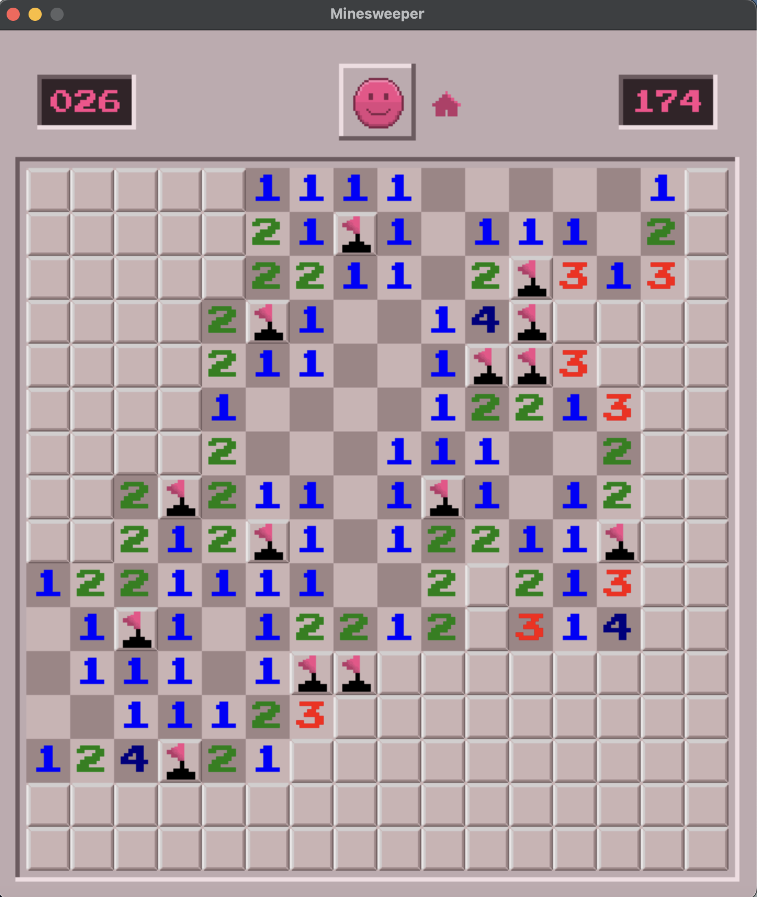
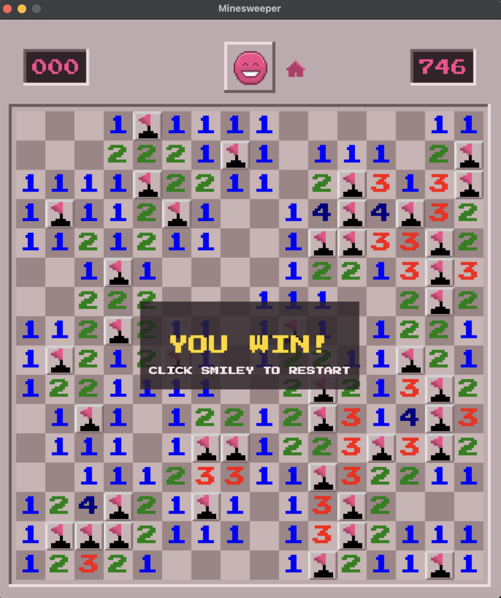
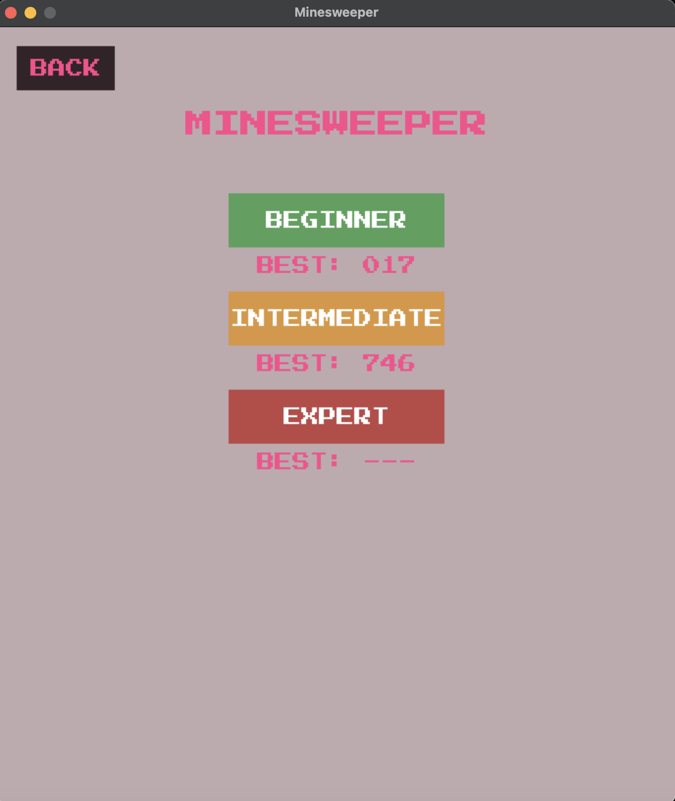

# Minesweeper

A pixel-art take on classic Minesweeper, built with Python and pygame.

<p align="center">
  
  
  
</p>

## Download

**[Download the latest release](https://github.com/sebnalli/Minesweeper/releases/latest)** (macOS, `Minesweeper-macOS.dmg`)

Windows build coming later.

## Features

- Three difficulties: Beginner (9×9, 10 mines), Intermediate (16×16, 40 mines), Expert (16×30, 99 mines)
- First-click mine protection
- Timer and mine counter
- Best time saved for each difficulty
- Custom pixel-art interface with win and loss screens
- Smiley button to restart, home button to change difficulty

## Install (macOS)

1. Download **Minesweeper-macOS.dmg** from the [latest release](https://github.com/sebnalli/Minesweeper/releases/latest).
2. Open the DMG and drag **Minesweeper** into **Applications**.
3. Launch Minesweeper from Applications.

> **"Minesweeper can't be opened"?** The app isn't notarized, so macOS may block it the first time. Right-click (or Control-click) Minesweeper in Applications, choose **Open**, then confirm. You only need to do this once.

## How to play

- **Left-click** a tile to reveal it.
- **Right-click** a tile to place or remove a flag.
- Numbers show how many mines touch that tile. Reveal every safe tile to win.

## Run from source

Requires Python 3 and pygame.

```bash
git clone https://github.com/sebnalli/Minesweeper.git
cd Minesweeper
pip install pygame
python -m src.gui.main
```

## Project structure

```
src/
├── core/   # game logic: board, cells, reveal and win checks
└── gui/    # pygame window, menus, high scores, assets
```
